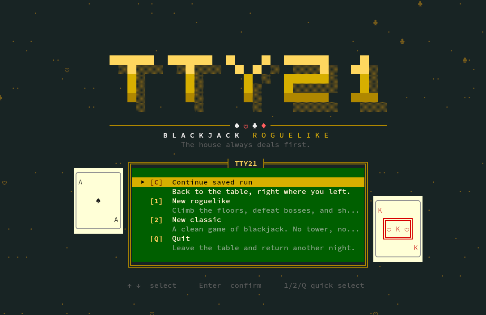
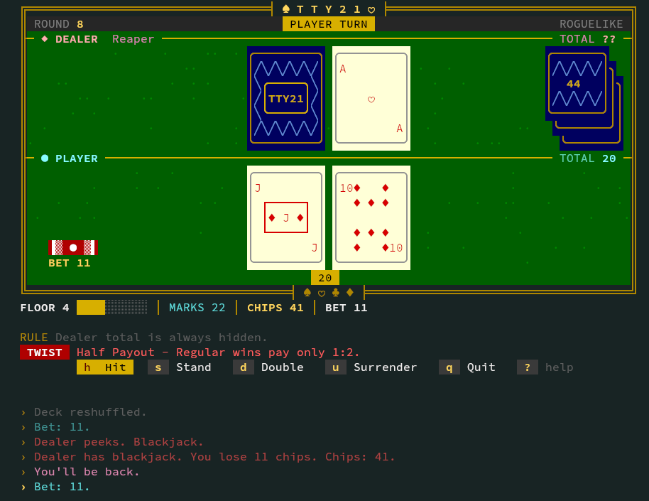
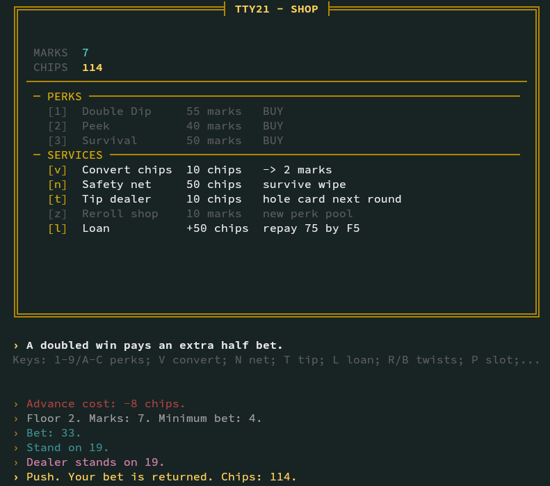

# tty21

**Blackjack, with a roguelike twist.**

tty21 is a terminal blackjack game written in C. Play a clean, traditional game or take on a run through increasingly dangerous casino floors, where dealers, bosses, table rules, and run-specific upgrades change how you play.

## Game modes

- **Classic** — straightforward blackjack, focused on the hand.
- **Roguelike** — climb through casino floors, face special dealers and bosses, adapt to table twists, and spend marks on upgrades between rounds.

Both modes include the familiar blackjack decisions: hit, stand, double down, split, surrender, and insurance when available.

## Installation

### Arch Linux

From a checkout of this repository:

```sh
makepkg -si
```

The Arch package recipe is included in the repository and is ready for AUR publication. It is not listed in the AUR yet.

### Other Linux distributions

Build and install from source:

```sh
make
sudo make install
```

The default install prefix is `/usr/local`. To stage files for packaging:

```sh
make PREFIX=/usr DESTDIR=/path/to/pkg install
```

## Getting started

```sh
make
./tty21
```

Run `./tty21` without arguments to open the mode selection menu. Requires Linux, a C11 compiler (GCC or Clang), and a terminal with ANSI escape-sequence support.

## Controls

| Action | Key |
| --- | --- |
| Hit | `h` |
| Stand | `s` |
| Double down | `d` |
| Split | `p` |
| Surrender | `u` |
| Show help | `?` |
| Continue / advance / shop | `c` / `a` / `s` |
| Save run | `w` |
| Quit | `q` |

Menus can be navigated with the arrow keys and Enter.

## Command-line options

| Option | Description |
| --- | --- |
| `--classic` | Start Classic mode |
| `--roguelike` | Start a new Roguelike run |
| `--continue` | Continue a saved run |
| `--seed N` | Use a repeatable random seed |
| `--fast` | Skip dealer animation pauses |
| `--ascii` | Use ASCII-only graphics |
| `--no-color` | Disable terminal colors |
| `--no-save` | Disable autosaving for this session |
| `--help` | Show all options |

## Development

```sh
make test
make test-sanitize
make simulate-report
```

The tests cover blackjack rules, progression, saves, rendering, command-line behavior, and terminal handling.

## Screenshots

| Main menu | Gameplay |
|:---:|:---:|
|  |  |

### Roguelike shop



## License

MIT. See [LICENSE](LICENSE).
